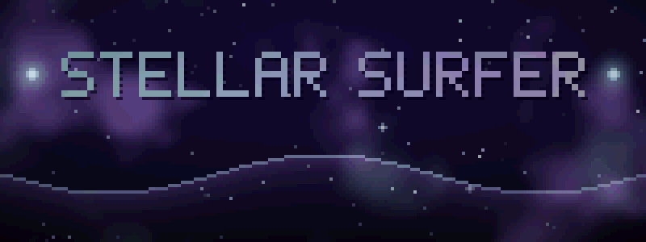

# ✦ Stellar Surfer

*Some fall from the sky. You were never meant to land.*

An origin for **Origins** (Minecraft **1.21.1**, **NeoForge**), made of two packs that are always used together:

| Folder | Pack | Install in |
|---|---|---|
| [`datapack/`](datapack) | **Stellar Surfer** — the origin, its powers and logic | `saves/<world>/datapacks/` |
| [`resourcepack/`](resourcepack) | **Stellar Surfer — Cosmic Visuals** — models, textures, HUD, sounds, texts (EN/FR) | `resourcepacks/` |

**Requirements:** Origins + Apoli (NeoForge 1.21.1). A matching Figura avatar exists separately and is not part of this repository.

## Download

Ready-to-use zips are attached to each [release](../../releases). Players should use the CurseForge pages; this repository tracks the project's history.

## Versions

The current version is in [`VERSION`](VERSION); every change is listed in [`CHANGELOG.md`](CHANGELOG.md).
Each release is tagged `vX.Y.Z` (both packs share the same number).

- `X.Y.Z+1` — fixes and small tweaks
- `X.Y+1.0` — new content
- `X+1.0.0` — changes that can break existing worlds

## Licence

All Rights Reserved — see [`LICENSE`](LICENSE).
